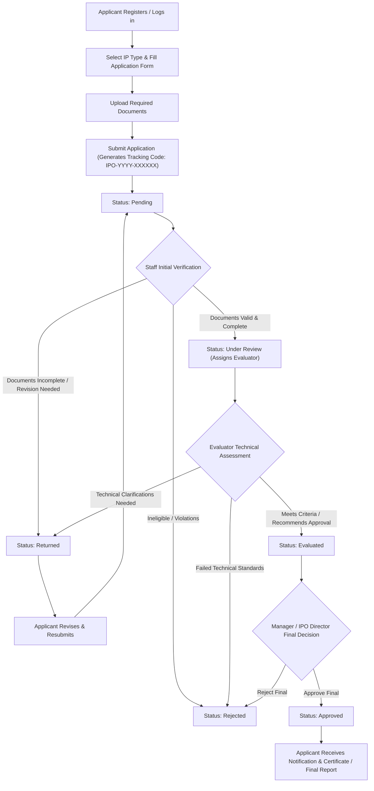
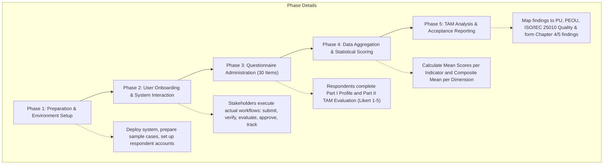

# System Evaluation Questionnaire Reference Guide
**Project:** Web-Based Management System for ZPPSU-IPO with Application Monitoring  
**Theoretical Framework:** Technology Acceptance Model (TAM) (Davis, 1989) & Software Quality Standards (ISO/IEC 25010)  
**Target Organization:** Zamboanga Peninsula Polytechnic State University – Intellectual Property Office (ZPPSU-IPO)

---

## 1. Document Overview

This document provides a complete specification of the research instrument, workflows, and evaluation questionnaire utilized to assess the acceptance, usability, quality, and effectiveness of the **Web-Based Management System for ZPPSU-IPO with Application Monitoring**.

### Purpose and Objectives
- Evaluate user acceptance based on Davis's (1989) **Technology Acceptance Model (TAM)**, particularly **Perceived Usefulness (PU)** and **Perceived Ease of Use (PEOU)**.
- Measure operational software characteristics: **Functional Sustainability, Usability, Performance Efficiency, Reliability, and Security**.
- Capture quantitative feedback across key stakeholder groups to validate system readiness, identify areas of improvement, and measure overall satisfaction.

---

## 2. Part I: Respondent Profile

### Form Fields
| Field | Type | Options / Specification | Notes |
| :--- | :--- | :--- | :--- |
| **Name** | Text | *Optional* | Preserves respondent anonymity if desired |
| **Age** | Number / Text | Open text / Numeric | Demographics tracking |
| **Address** | Text | Open text | Demographics tracking |
| **Gender** | Single Choice | - Male<br>- Female<br>- Prefer not to say | |
| **Role / Affiliation** | Single Choice | - **IPO Director**<br>- **IPO Staff**<br>- **Faculty Researcher**<br>- **Student Researcher**<br>- **Administrative Personnel**<br>- **Other** (Specify: `_________`) | Primary stakeholder classification |
| **Date of Evaluation** | Date | `YYYY-MM-DD` / Date format | Timestamp of evaluation |

---

## 3. Part II: System Evaluation (TAM Instrument)

### Likert Rating Scale
All evaluation items are rated on a standard **5-point Likert Scale**:

| Rating | Description | Typical Mean Interpretation Range |
| :---: | :--- | :---: |
| **5** | **Strongly Agree** | 4.21 – 5.00 |
| **4** | **Agree** | 3.41 – 4.20 |
| **3** | **Neutral** | 2.61 – 3.40 |
| **2** | **Disagree** | 1.81 – 2.60 |
| **1** | **Strongly Disagree** | 1.00 – 1.80 |

---

## 4. Evaluation Categories & Statements

### A. Functional Sustainability
> **Description:** Evaluates whether the system provides the functions necessary to support the management and monitoring of IP applications and related documents.

| No. | Statement | Primary Focus |
| :---: | :--- | :--- |
| **1** | The system provides the functions needed to manage IP applications. | Core IP management functionality |
| **2** | The system makes IP application submission more convenient. | Application workflow convenience |
| **3** | The system helps users monitor the status and progress of IP applications. | Real-time tracking and monitoring |
| **4** | The system provides useful functions for uploading and managing IP application documents. | Document repository and management |
| **5** | The system provides useful notifications and reports for IP application management. | Alerts, reporting, and communication |

---

### B. Usability
> **Description:** Evaluates how easy the system is to learn, understand, navigate, and use. *(Corresponds to TAM Perceived Ease of Use)*

| No. | Statement | Primary Focus |
| :---: | :--- | :--- |
| **6** | I find the system easy to use. | General ease of use |
| **7** | I find the system's interface clear and organized. | UI layout and aesthetic cleanliness |
| **8** | I can easily navigate through the system's pages and features. | UX navigation and structure |
| **9** | I can easily understand the labels, buttons, and instructions in the system. | Clarity of copy, signage, and cues |
| **10** | I can easily learn how to use the system. | Learnability and cognitive onboarding |

---

### C. Performance Efficiency
> **Description:** Evaluates whether the system performs its functions efficiently and helps users complete IP application-related tasks within a reasonable time.

| No. | Statement | Primary Focus |
| :---: | :--- | :--- |
| **11** | The system responds quickly when I perform an action. | System responsiveness / latency |
| **12** | The system allows me to complete IP application tasks efficiently. | Task throughput and productivity |
| **13** | Application status and monitoring information are displayed without unnecessary delay. | Monitoring data freshness and speed |
| **14** | The system allows documents to be uploaded and accessed within a reasonable time. | Document I/O and asset access speed |
| **15** | The system helps me complete my tasks efficiently. | Overall efficiency enhancement |

---

### D. Reliability
> **Description:** Evaluates whether the system consistently performs its intended functions and properly maintains IP application information and documents.

| No. | Statement | Primary Focus |
| :---: | :--- | :--- |
| **16** | The system performs its functions consistently. | Operational consistency |
| **17** | The system saves IP application information correctly. | Data integrity and persistence |
| **18** | The system properly maintains uploaded documents and application records. | Document and record retention safety |
| **19** | The system operates without frequent errors or interruptions. | Fault tolerance and stability |
| **20** | I can rely on the system when I need to perform IP application-related tasks. | Dependability and user trust |

---

### E. Security
> **Description:** Evaluates whether the system protects user accounts, IP application records, documents, and other information from unauthorized access or changes.

| No. | Statement | Primary Focus |
| :---: | :--- | :--- |
| **21** | The system provides appropriate protection for user login information. | Authentication security and credential handling |
| **22** | The system restricts access to features based on user authorization. | Role-Based Access Control (RBAC) |
| **23** | The system protects IP application records and documents from unauthorized access. | IP confidentiality and data privacy |
| **24** | The system helps prevent unauthorized changes to application records. | Auditability and tamper resistance |
| **25** | I feel that my information and application data are protected when using the system. | User perception of system security |

---

### F. Overall Satisfaction and User Acceptance
> **Description:** Evaluates the user's overall experience, satisfaction, and willingness to accept and use the proposed system. *(Corresponds to TAM Attitude Toward Using & Behavioral Intention to Use)*

| No. | Statement | Primary Focus |
| :---: | :--- | :--- |
| **26** | The system meets my needs for IP application-related tasks. | Task alignment and fit |
| **27** | Using the system makes IP application management more convenient. | Perceived utility and workflow uplift |
| **28** | I am satisfied with the way the system supports IP application monitoring. | Satisfaction with tracking features |
| **29** | Overall, I am satisfied with the performance of the system. | Overall user satisfaction |
| **30** | I would support the use of this system for managing IP applications at ZPPSU-IPO. | Behavioral intention & institutional adoption |

---

## 5. System & Research Workflows

### 5.1 End-to-End Application Management & Monitoring Lifecycle (System Workflow)
This workflow outlines the exact state machine and user interactions within the Web-Based Management System for ZPPSU-IPO:



#### Key Roles and Responsibilities in the Workflow
1. **Applicant (Student / Faculty / Staff / External Innovator):**
   - Registers account with collegiate and departmental affiliation.
   - Files IP applications across 5 categories: *Patent, Utility Model, Industrial Design, Trademark, Copyright*.
   - Uploads required legal/technical documentation.
   - Tracks real-time status through personal dashboard and unique tracking code (`IPO-YYYY-XXXXXX`).
   - Resubmits revised documents when returned by staff or evaluators.

2. **IPO Staff:**
   - Performs document completeness screening and triage.
   - Updates status history with verification remarks.
   - Returns deficient submissions for corrections or rejects invalid applications.
   - Forwards verified applications to a qualified technical evaluator.

3. **Technical Evaluator:**
   - Reviews technical claims, descriptions, and supporting diagrams.
   - Enters evaluation findings, technical comments, and recommendation (`evaluated`).

4. **IPO Manager / Director:**
   - Reviews comprehensive submission, staff verification logs, and evaluator notes.
   - Issues official office decision (`approved` or `rejected`).
   - Generates summary reports, analytics, and operational metrics.

5. **System Administrator:**
   - Manages user accounts, role permissions, college/department hierarchies, IP application types, and audit logging.

---

### 5.2 TAM System Evaluation & Research Workflow
This workflow details the process of administering the evaluation questionnaire and analyzing the research data:



#### Step-by-Step Evaluation Execution:
1. **Pre-Evaluation Briefing:** Orient respondents (Directors, Staff, Researchers, Students) on system goals and evaluation scope.
2. **Hands-On System Simulation / Real Usage:** Respondents perform realistic tasks (e.g., submitting an IP document, searching status, reviewing an application).
3. **Questionnaire Collection:** Gathering responses across all 6 dimensions (A through F) either digitally or via printed instrument.
4. **Data Tabulation & Computation:** Compute frequency distribution, indicator weighted means ($\bar{X}$), and overall category means.
5. **Verbal Interpretation & Conclusion:** Translate quantitative mean values into standard descriptive ratings (e.g., *Highly Acceptable / Strongly Agree*) to prove user acceptance in the capstone study.

---

## 6. Technical Mapping & Implementation Guidelines

### TAM & ISO/IEC 25010 Construct Mapping
```
Questionnaire Construct          TAM Dimension                   ISO/IEC 25010 Quality Model
----------------------          -------------                   ---------------------------
A. Functional Sustainability -> Perceived Usefulness (PU)    -> Functional Suitability
B. Usability                 -> Perceived Ease of Use (PEOU) -> Usability / Learnability
C. Performance Efficiency    -> Perceived Usefulness (PU)    -> Performance Efficiency
D. Reliability               -> Trust & System Quality       -> Reliability / Fault Tolerance
E. Security                  -> Trust & System Quality       -> Security / Confidentiality
F. Overall Satisfaction      -> Attitude & Intention to Use  -> Satisfaction / Quality in Use
```

### Suggested Database Schema for Digital Evaluation Module
If this questionnaire is built directly into the web application, the following relational structure can be referenced:

```sql
-- Evaluation Respondents Table
CREATE TABLE IF NOT EXISTS evaluation_respondents (
    id INT AUTO_INCREMENT PRIMARY KEY,
    name VARCHAR(255) NULL,
    age INT NULL,
    address VARCHAR(255) NULL,
    gender ENUM('Male', 'Female', 'Prefer not to say') NOT NULL,
    role ENUM('IPO Director', 'IPO Staff', 'Faculty Researcher', 'Student Researcher', 'Administrative Personnel', 'Other') NOT NULL,
    other_role VARCHAR(100) NULL,
    evaluation_date DATE NOT NULL,
    created_at TIMESTAMP DEFAULT CURRENT_TIMESTAMP
);

-- Evaluation Responses Table (30 Statements)
CREATE TABLE IF NOT EXISTS evaluation_responses (
    id INT AUTO_INCREMENT PRIMARY KEY,
    respondent_id INT NOT NULL,
    q1 TINYINT NOT NULL, q2 TINYINT NOT NULL, q3 TINYINT NOT NULL, q4 TINYINT NOT NULL, q5 TINYINT NOT NULL,
    q6 TINYINT NOT NULL, q7 TINYINT NOT NULL, q8 TINYINT NOT NULL, q9 TINYINT NOT NULL, q10 TINYINT NOT NULL,
    q11 TINYINT NOT NULL, q12 TINYINT NOT NULL, q13 TINYINT NOT NULL, q14 TINYINT NOT NULL, q15 TINYINT NOT NULL,
    q16 TINYINT NOT NULL, q17 TINYINT NOT NULL, q18 TINYINT NOT NULL, q19 TINYINT NOT NULL, q20 TINYINT NOT NULL,
    q21 TINYINT NOT NULL, q22 TINYINT NOT NULL, q23 TINYINT NOT NULL, q24 TINYINT NOT NULL, q25 TINYINT NOT NULL,
    q26 TINYINT NOT NULL, q27 TINYINT NOT NULL, q28 TINYINT NOT NULL, q29 TINYINT NOT NULL, q30 TINYINT NOT NULL,
    comments TEXT NULL,
    FOREIGN KEY (respondent_id) REFERENCES evaluation_respondents(id) ON DELETE CASCADE
);
```

### Statistical Analysis Formulas
- **Mean Score per Indicator:**  
  $$\bar{X} = \frac{\sum (f \cdot w)}{N}$$  
  Where $f$ = frequency of responses, $w$ = scale weight (1 to 5), $N$ = total number of respondents.
- **Composite Mean per Category:**  
  $$\text{Category Mean} = \frac{\sum \bar{X}_{\text{items}}}{n_{\text{items}}}$$
- **Standard Interpretation:**  
  - 4.21 – 5.00: Highly Acceptable / Strongly Agree  
  - 3.41 – 4.20: Acceptable / Agree  
  - 2.61 – 3.40: Moderately Acceptable / Neutral  
  - 1.81 – 2.60: Low Acceptability / Disagree  
  - 1.00 – 1.80: Not Acceptable / Strongly Disagree  
